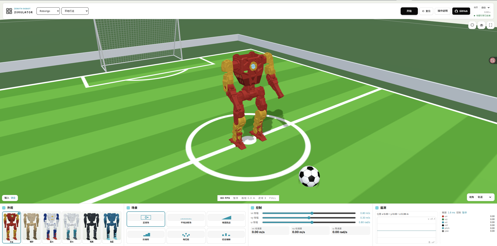
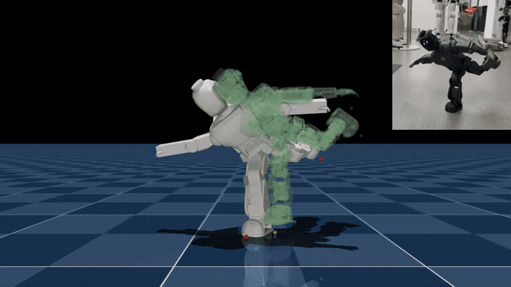
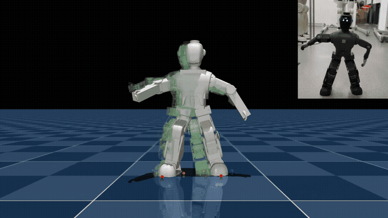
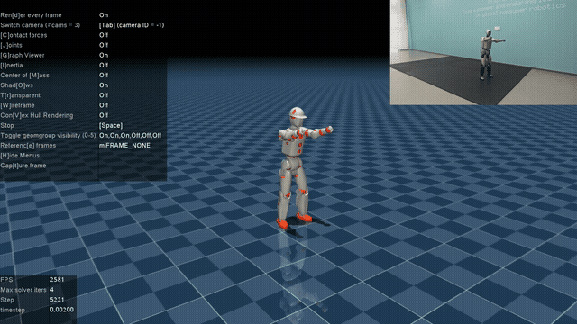
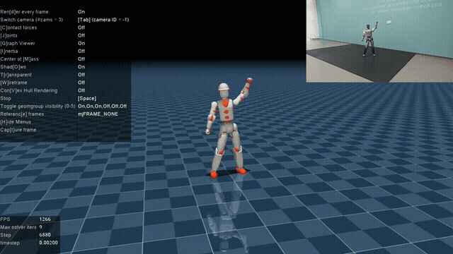
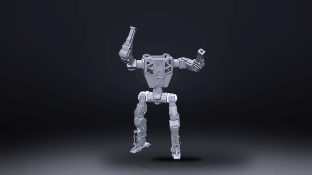
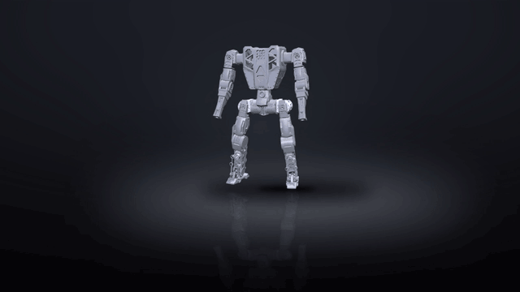

  
  <h1>ZerothRobot</h1>
  
<strong>The Pioneer of Consumer-Grade Embodied Intelligence</strong>

  

    <a href="README.zh-CN.md">简体中文</a> ·
    <a href="https://www.zeroth0.com/">Official website</a> ·
    <a href="https://zerothrobot.github.io/docs/">Documentation center</a>
  

---

## Who We Are

Zeroth, under Suzhou JoyIn Intelligent Technology Co., Ltd., is a high-tech enterprise dedicated to the research, development, and application of robotics and artificial intelligence.

With embodied intelligence at its core, Zeroth is shaping the next era of consumer robotics. We believe robots are not merely extensions of technology, but reflections of human consciousness, emotion, and imagination.

Our mission is to bring robots into everyday life, using advanced technology to free humanity from the ordinary and enrich the essence of living.

At Zeroth, we are leading the next wave of consumer robotics.

## Explore our projects

### Online simulator

[Open the ZerothRobot simulator →](https://huggingface.co/spaces/ZerothRobot/ZerothRobot-simulator)

  

## M1 EDU

Your first RL-powered humanoid robot.

[Explore M1 EDU →](https://github.com/ZerothRobot/M1_EDU)

  
  

## Bridge

AI-native. Built to move your way.

[Explore OpenBridge →](https://github.com/ZerothRobot/openbridge)

  
  

## RoboRigo

A fully open-source DIY robotics platform.

[Explore the RoboRigo repository →](https://github.com/ZerothRobot/roborigo)

  
  

A robot dance and a fall recovery, both performed by the same policy.

## Join the community

QQ and WeChat communities are in the works. Stay tuned for updates.
