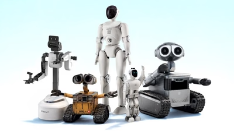

  

  <h1>ZerothRobot</h1>
  
<strong>引领消费级具身智能。</strong>

  
<a href="README.md">English</a> · <a href="https://www.zeroth0.com/">官方网站</a>

  

## 关于 Zeroth

元点智能 Zeroth 是苏州乐享智能科技有限公司旗下以具身智能为核心的消费级机器人品牌，专注于机器人与人工智能的研发及应用。我们相信，机器人不只是技术工具，也是人类意识、情感与想象力的延伸。我们希望以先进科技丰富生活，并推动消费级机器人走进更多真实场景。

## 探索我们的产品与开源项目

| 项目 | 方向 | 仓库 |
| --- | --- | --- |
| **M1 EDU** | 面向教育与二次开发的迷你机器人，开放强化学习训练基线。 | [Zeroth-M1](https://github.com/ZerothRobot/Zeroth-M1) |
| **Bridge / OpenBridge** | 高性能小型人形机器人及其开源生态，覆盖硬件、技能与仿真。 | [openbridge](https://github.com/ZerothRobot/openbridge) |
| **Joyin Arm** | 机械臂教学与开发平台，包含运动学、控制及 ROS 2 教程。 | [Joyin-Arm](https://github.com/joyin-dexhand/Joyin-Arm) |
| **Origo** | 3D 打印全开源人形机器人，覆盖结构、训练、部署与 Web 体验。 | [origo](https://github.com/origo-robotics/origo) |

> 仓库归属和名称仍在整理中；如项目迁移，请以对应仓库的最新信息为准。

## 加入社区，关注 Zeroth

QQ 和微信社群入口请访问官网获取最新信息。
